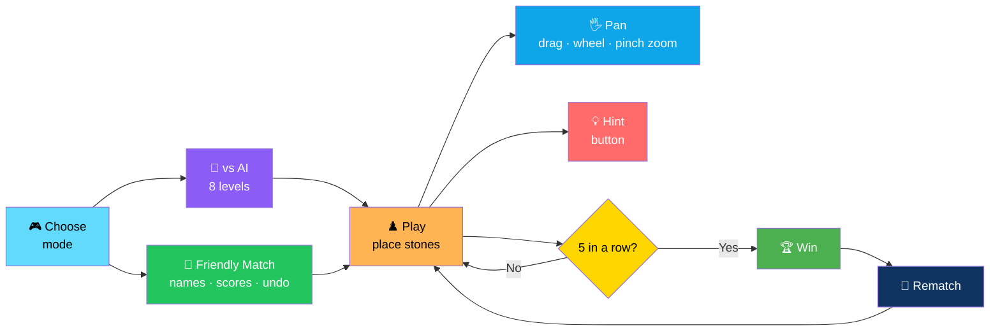
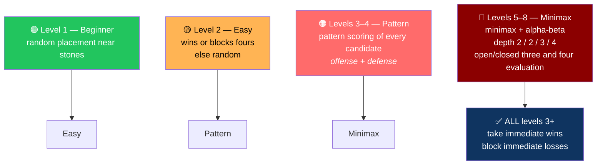
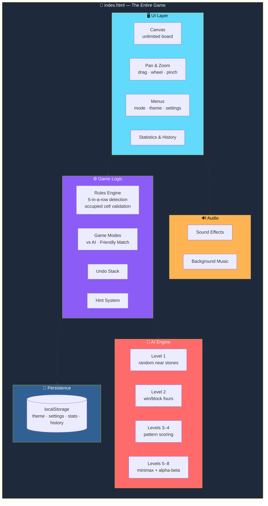

# ⭕ Ultimate O & X — Five in a Row

<div align="center">

**By Y Pengly · v1.1.0**


**The classic game, reimagined — on an infinite board.**

*Play against a friend or challenge the AI across eight difficulty levels*

[🎮 Run Locally](#-run-locally) • [✨ Features](#-features) • [🤖 AI System](#-ai-system) • [🧪 Testing](#-testing-checklist) • [🚀 Deploy](#-deploy-online)

</div>

---

## 📖 Overview

**Ultimate O & X** is a polished, expanded take on the classic **Five in a Row** game.

### Core Idea

> **The board has no edges.**
>
> Drag, zoom, and place stones anywhere. The only limit is how far you're willing to go to get five in a row.

### The Experience



---

## 🚀 Run Locally

### Just Open It

**Open `index.html` in any modern browser** — Chrome, Edge, Firefox, Safari.

> ✅ **No install or internet needed.**

### Optional — Serve It Locally

```bash
python3 -m http.server 8000
```

**Then visit http://localhost:8000.**

---

## 🚀 Deploy Online

**Upload the folder to any static host:**

- **Netlify Drop**
- **GitHub Pages**
- **Vercel**
- **Cloudflare Pages**

> 💡 **It is a static site** — **just `index.html`**.

---

## ✨ Features

<div align="center">

| ♾️ Unlimited Board | 🤖 vs AI |
|:---:|:---:|
| **Drag · wheel / pinch zoom** | **8 difficulty levels** |
| **👥 Friendly Match** | **💡 Hint Button** |
| Names · scores · **undo** · **rematch** | Get a suggestion when you're stuck |
| **🎨 8 Themes** | **📊 Statistics & History** |
| **Full visual variety** | Track your record across sessions |
| **🔊 Sound · Music · Animation** | **📱 Fully Responsive** |
| **All configurable in settings** | **Phone · tablet · desktop** |
| **💾 LocalStorage Persistence** | |
| **Everything saved automatically** | |

</div>

---

## 🤖 AI System

> **Eight difficulty levels, each with a distinct approach.**



### 🎯 Level Breakdown

<div align="center">

| Level | Approach |
|:-----:|----------|
| **1** | **Beginner** — random placement near existing stones |
| **2** | **Easy** — wins or blocks fours, otherwise random |
| **3–4** | **Pattern scoring** of every candidate *(offense + defense)* |
| **5–8** | **Minimax + alpha-beta** over the best-ranked candidates · depths **2 / 2 / 3 / 4** · with **open/closed three and four evaluation** |

</div>

> ✅ **All levels 3+ take immediate wins and block immediate losses.**

---

## 🧪 Testing Checklist

> **Manual test scenarios that verify the game's correctness.**

<div align="center">

| Area | Checks |
|:----:|:------:|
| **♟️ Win detection** | **Horizontal, vertical, and both diagonal** 5-in-a-row wins · **4 does NOT win** · **6 wins** |
| **🎯 Cell validation** | **Occupied cells rejected** · **board panned far away keeps working** |
| **🤖 AI behavior** | **AI wins when it can** · **blocks open fours** *(levels 3–8)* |
| **🔄 Game controls** | **Undo** *(both modes)* · **Hint** · **pause / resume / restart / draw / exit** |
| **💾 Persistence** | **Reload** — theme, settings, stats, history **all persist** |
| **📱 Mobile** | **Pinch zoom** · **one-finger drag** · **tap to place** · **no page scroll** |

</div>

---

## 🏗️ Architecture

### System Overview



### Design Principles

<div align="center">

| Principle | Implementation |
|-----------|---------------|
| **♾️ Infinite by design** | The board has **no bounds** — **drag, wheel, and pinch zoom** let the game grow as far as the match requires |
| **🎯 Two ways to play** | **vs AI** *(8 levels)* or **Friendly Match** *(names, scores, undo, rematch)* — **both share the same rules engine** |
| **🤖 AI scales honestly** | Each level uses **a genuinely different strategy** — **not the same engine with different search depths** |
| **✅ Safety net for all levels 3+** | **Immediate wins taken, immediate losses blocked** — **even the pattern scorers don't miss easy moves** |
| **🔄 Full undo in both modes** | Mistakes are reversible — **experimenting is encouraged** |
| **💾 Local persistence** | **Theme, settings, stats, and history** all saved in `localStorage` |
| **📱 Mobile-first interactions** | **Pinch zoom, one-finger drag, tap to place** — **no page scroll** |
| **🎨 Eight themes** | **Meaningful visual variety** — not just a color swap |

</div>

---

## 🗺️ Roadmap

### ✅ Current

- [x] Single-file, dependency-free HTML game
- [x] Unlimited board with no boundaries
- [x] Drag to pan the board
- [x] Wheel / pinch zoom
- [x] vs AI mode with **8 difficulty levels**
- [x] Friendly Match mode with names, scores, undo, and rematch
- [x] Hint button
- [x] **8 themes**
- [x] Statistics tracking
- [x] History log
- [x] Sound effects
- [x] Background music
- [x] Animation settings
- [x] Responsive layout for phone, tablet, and desktop
- [x] **LocalStorage persistence** for theme, settings, stats, and history
- [x] **Full win detection** — horizontal, vertical, and both diagonals
- [x] **Correct length handling** — 4 does not win, 6 does win
- [x] **Occupied cell validation**
- [x] **Board panned far away** still works correctly
- [x] **Undo** in both AI and Friendly Match modes
- [x] **Pause / resume / restart / draw / exit** controls
- [x] **AI Level 1** — random near existing stones
- [x] **AI Level 2** — wins or blocks fours, else random
- [x] **AI Levels 3–4** — pattern scoring with offense and defense
- [x] **AI Levels 5–8** — minimax with alpha-beta and open/closed three and four evaluation
- [x] **All levels 3+ take immediate wins and block immediate losses**
- [x] **Mobile interactions** — pinch zoom, one-finger drag, tap to place, no page scroll
- [x] Deployable to any static host — Netlify Drop, GitHub Pages, Vercel, Cloudflare Pages

### 🔜 Future Ideas

- [ ] **Online multiplayer** — would require a real backend or WebRTC
- [ ] **Additional themes** beyond the current 8
- [ ] **Additional AI levels** beyond 8
- [ ] **Daily challenge** with a fixed opening
- [ ] **Local leaderboards** by AI level
- [ ] **Replay system** — review and share matches
- [ ] **Puzzle mode** — solve "win in N moves" scenarios
- [ ] **Accessibility options** — colorblind palettes, keyboard-only navigation
- [ ] **PWA support** — install and play offline
- [ ] **Localization** — bilingual UI

---

## 🤝 Contributing

Contributions are welcome. Please:

1. Fork the repository
2. **Keep it single-file** — no external build step, no bundler
3. **Keep it dependency-free** — no frameworks, no assets
4. **Preserve infinite board behavior** — panning far away must never break
5. **Keep all 8 AI levels distinct** — not the same engine with different search depths
6. **Preserve immediate win/loss detection** for levels 3+
7. **Keep win detection exact** — 4 does not win, 5 does, 6 does
8. **Keep mobile interactions working** — pinch zoom, drag, tap, no page scroll
9. Test against the [testing checklist](#-testing-checklist) before submitting
10. Submit a Pull Request

### Guidelines

- **Never break LocalStorage compatibility** without a migration path
- **Never present a stub as a feature**
- **Never reduce AI distinctiveness** — each level has a purpose
- **Never break the infinite board** — it's the defining feature
- **Never require a backend** — the game must work from `file://`

---

## 📜 License

MIT — see [LICENSE](LICENSE) for details.

---

## 🙏 Acknowledgments

- **The original Five in a Row** — for the game that never gets old
- **Every player who's ever said "just one more round"** — this one's for you

---

<div align="center">

### ⭕ FIVE IN A ROW. ON AN INFINITE BOARD.

**The classic game, reimagined.**

**Eight AI levels. Eight themes. Two ways to play. Zero dependencies.**

<br>

### By Y Pengly · v1.1.0

<br>

⭐ If Ultimate O & X gave you a good match, consider giving it a star.

<br>

[⬆ Back to Top](#-ultimate-o--x--five-in-a-row)

</div>
